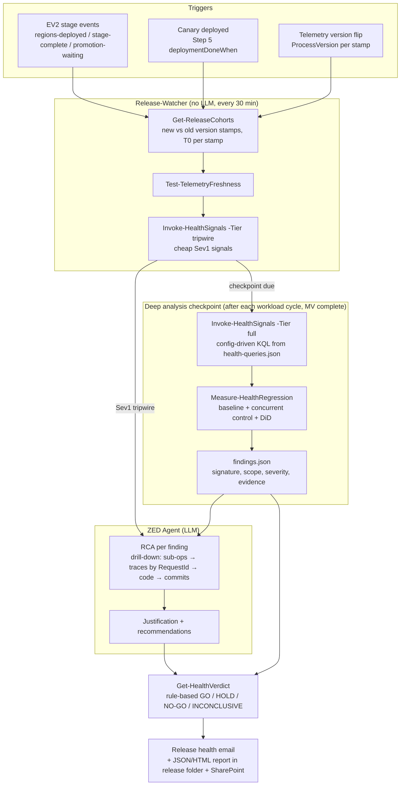

# ZED Release Health Analysis — Design

**Status:** Approved and implemented (engine `.github/skills/zed-agent/scripts/Health/`, agent contract `reference/release-health.md`, onboarding `setup-service group 11`; BCM skill `bcm-release-health` in the BCM repo) · **Pilot service:** BCM · **Date:** 2026-10-29

ZED currently drives the release *mechanics* (trigger, EV2 polling, stage notifications). It does
not judge release *health*. Release owners decide whether to promote by checking the
[BCM Release Health Dashboard](https://dataexplorer.azure.com/dashboards/2fd63c8d-5ccf-49ff-8cce-fbcff75f8f0c).
This design moves that judgement into ZED. ZED automatically analyses each canary and SDP stage,
performs RCA on regressions, and sends the team a **GO / NO-GO** recommendation with evidence
before the next stage is promoted.

---

## 1. Goals and non-goals

### Goals
1. **Catch regressions early.** Start analysing as soon as a stamp runs the new build, rather than
   when managed validation (MV) ends. The MV bake period is a continuous watch period.
2. **Issue a final, evidence-based Go/No-Go at MV completion** for Canary, Low, Medium, Heavy, and
   any later production stage.
3. **Cover workload health, sub-operations, error signatures, and resource health:** backup,
   restore, protection, dependency calls, traces, CPU, memory, exceptions, and process restarts.
4. **Perform RCA for each new or spiking failure signature.** Analysing every failed operation
   individually is impractical because BCM produces hundreds of expected customer errors per hour.
5. **Keep Kusto queries in per-service config.** Other services can onboard by adding config and
   KQL files, without changing ZED code.
6. **Make decisions explainable and reproducible.** The same telemetry must produce the same
   verdict, and every claim in the email must link to its supporting query.

### Non-goals (for v1)
- ZED does **not** auto-promote and **never** stops or rolls back the rollout. A NO-GO is
  **notification only**, as the BCM team decided. A human owns promotion, rollback, and EV2 stop.
- No replacement of EV2 health checks or ICM monitors. This analysis complements them.
- No ML training infrastructure. Use statistics that KQL and PowerShell can compute.

---

## 2. Key findings from BCM telemetry (validated 2026-10-28)

These checks against `mabprod1/MABKustoProd1` drive the design:

| Finding | Evidence | Design consequence |
|---|---|---|
| **Telemetry reports the build version for each stamp.** `OperationStatsLocalAll.ProcessVersion` (e.g. `3.0.883.0-master` vs `3.0.886.0-master`) by `DeploymentUnit` and `Role`. | BCM2610_2 flips are visible: `ncus`/`wcus`/`ea` on 10/25 at 10:00Z (Low), `ne` on 10/26 at 05:51Z (Medium), and ~20 stamps on 10/28 at 04:28Z (Heavy). | Use each stamp's **telemetry-detected flip time** as T0, not the EV2 timestamp. Split stamps into **new-version** and **previous-version cohorts**. |
| `SourceVersion` (`Ver22v0`) is a **schema** version, not the build. | Same value on all stamps. | Do not use it for version attribution. |
| `DeploymentUnit` (`<region>-pod01-coord-01-sf`) is in all six tables. | Present in every schema. | `DeploymentUnit` is the common join key for every signal. |
| Stats tables lag about **6–11 min**. | `max(TIMESTAMP)` vs `now()`. | Run the first check at T0 + 45 min. Every run checks freshness; stale data produces **INCONCLUSIVE**, not GO. |
| `TraceLogMessageAll` is very large: **~53M BCM rows in 30 min**. `TraceLogMessage` is the same BCM Web and TEE role log, but it is **local to `mabprod1`**. | 2026-10-28 04:00–06:30Z: upgrade lifecycle events for 9 stamps (`gwc`, `frs`, `wus3`, `ukw`, `bse`, `nwe`, `nww`, `sdc`, …) are only in `TraceLogMessageAll`. | Query **`TraceLogMessageAll`** for complete stamp coverage. Do not scan it broadly: use only the upgrade window, Level ≤ 1 fingerprints on new-version stamps, and sampled RequestIds. A new-version stamp with no lifecycle events is **INCONCLUSIVE** for upgrade health. |
| Backup failures are dominated by customer errors, e.g. `UserErrorGuestAgentStatusUnavailable` with 923 failures in 2 h. | Top error codes over 2 h. | Separate **service errors** from **user errors**. A user-error spike can still indicate a regression, such as a classification bug, but it receives lower severity. |
| **`ExpectedCloudErrors.xml` is far more accurate than a `^UserError` prefix rule.** The file defines 4,906 error names; 2,753 have `<UserError>true</UserError>`. | It covers 34 of the top 35 live failure codes over 6 h (backup, restore, and protection). It classifies about **3,700 failures without the prefix** as user errors, including `CloudDosAbsoluteLimitReached`, `BMSUserErrorObjectLocked`, and `GuestAgentSnapshotTaskStatusError`. It correctly keeps `BCMCrpInternalError`, `BCMProtTLGetDsInfoFailed`, `BCMProtGetSaSUriAsyncError`, and `SystemBackupOperationInProgress` as service errors. Only `ErrorCode == "null"` (101 failures) is unmapped. | Use the XML as the **authoritative classifier** (§6.2). Treat unmapped or null codes as service errors and flag them as unclassified. |
| **Canary stamps** are `ccy-pod01`, `ecy-pod01`, and `ea-can02`. Their main units are `ccy-pod01-coord-01-sf`, `ecy-pod01-coord-01-sf`, and `ea-can02-coord-01-sf`. | Sub-partitions (`*-coord-01-p1a…p1g-sf`) run many private, buddy, and develop builds at once, e.g. `3.0.1877.11-users_haary_…`, `3.0.1887.0-buddyCBA-…`, and `3.0.1900.0-develop`. | Cohorts must use an **exact release-version match**, not "anything newer". Exclude `-users*`, `-user_*`, `-buddy*`, `-dev_*`, and `-develop` builds. |
| **Version format** is `<ADO buildNumber>-<branch name with special characters replaced by '_'>`. Official deployments are `-master` or `-release*`. | e.g. `3.0.886.0-master` and `3.0.1898.2-releases_commonMSbuildTesting`. | Compute the expected `ProcessVersion` from the release build, and accept only official suffixes (§6.1). |
| **`BMSProtectionStatsAll.DeploymentName`** is the BCM stamp short code (`eus-pod01`, `cnc-pod01`, …); `ContainerLocation` is the VM location. | e.g. `eus-pod01` → `eastus`. | Attribute protection operations to BCM stamps using `DeploymentName` = the BCM `DeploymentUnit` prefix. Do not use `ContainerLocation` for attribution. |
| **VM-level counters are in `CounterEventsLocalAllClusters`** (`ServiceName == "ic"`), with one `RoleInstance` per VM. | 12–46 instances and about 60 counters per BCM stamp. Counters include `\Processor(_Total)\% Processor Time`, `\Memory\Available MBytes`, `\Memory\Committed Bytes`, `\.NET CLR Exceptions(_Global_)\# of Exceps Thrown / sec`, `\System\Processor Queue Length`, and `\TCPv4\Connections Established`. | Use this table for all CPU and memory analysis. Analyse per `RoleInstance` because each VM hosts a BCM role. |
| **BCM trace logs record the service upgrade lifecycle** for the Web and TEE roles, including `ProcessVersion`. | Heavy flip on `ae-pod01` (10/28): the old build logs `Exiting BCMTeeService RunAsync() loop {stopRequested = True}`; the new build logs `RunAsync - Initialized completed for BCMTeeService/BCMWebService {initialized = True}`. Level 2 is mostly verbose warnings, e.g. `ThrottlingHelper: …` 2,794×; Level 0–1 are errors. | Add a dedicated **upgrade-health** signal (§7.4). Use Level ≤ 1 for error fingerprints, and treat Level 2 only as supporting context. |

---

## 3. Approach options considered

| Option | Description | Verdict |
|---|---|---|
| **A. Port dashboard queries + fixed thresholds** | Run the dashboard tiles and compare them with static limits. | ❌ Static thresholds are noisy across large and small stamps. They cannot separate release effects from global incidents, and they keep the dashboard's blind spots. |
| **B. LLM reads raw telemetry and decides** | Give the agent query access and let it judge. | ❌ Non-reproducible, expensive on large tables, hard to audit, and prone to confident false conclusions. |
| **C. Deterministic detection + statistical comparison + agent-led RCA + rule-based verdict** *(recommended)* | Scripts compute signals and statistics. Rules determine severity and verdict. The agent investigates findings and writes the RCA and justification. | ✅ Reproducible, testable with Pester, and inexpensive. The agent handles the judgement-heavy RCA, but not the final call. |

**Core principle:** *Detection and verdict are deterministic; investigation and explanation are
handled by the agent.* The agent may **escalate** GO to HOLD, but it can never clear a deterministic
NO-GO. Only a human can override a NO-GO, and every override is audited.

---

## 4. Architecture



### 4.1 Components

| Component | Type | Responsibility |
|---|---|---|
| `health-queries.json` (+ `health-queries.schema.json`) | Per-service config | Data sources, scope filters, cohort detection, signals, thresholds, error classification, RCA drill-downs, verdict policy, and suppressions (§6). |
| `queries/health/<service>/*.kql` | KQL templates | One file per signal or drill-down. Templates return **aggregates only** so result sets stay small. |
| `scripts/Health/Invoke-HealthKusto.ps1` | Script | Calls Kusto REST (`/v2/rest/query`) using the existing `az` token pattern from `Get-StampInventory.ps1`. Handles placeholder substitution, timeouts, retries, and row caps, so the watcher can query without MCP. |
| `scripts/Health/Get-ReleaseCohorts.ps1` | Script | Derives the expected `ProcessVersion` from the release build and detects each stamp's T0 (first telemetry from that exact version). Builds new-version and previous-version cohorts, and reports EV2-vs-telemetry mismatches. |
| `scripts/Health/Get-ErrorClassification.ps1` | Script | Downloads `ExpectedCloudErrors.xml` from ADO and caches a name → `userError` map by commit ID (§6.2). |
| `scripts/Health/Invoke-HealthSignals.ps1` | Script | Runs the configured signals for a tier (`tripwire` / `full`) and writes raw aggregates. |
| `scripts/Health/Measure-HealthRegression.ps1` | **Pure** script (no I/O) | Runs the statistical comparisons and practical-significance checks, then generates findings. Fully unit-tested. |
| `scripts/Health/Get-HealthVerdict.ps1` | **Pure** script | Applies `verdictPolicy` to findings and data quality. Returns the verdict and deterministic reasons. |
| `scripts/Health/New-HealthReport.ps1` | Script | Produces the JSON report, HTML email, and ADX deep links for each evidence item. |
| `templates/release-health-email.html` | Template | Go/No-Go email (§10). |
| `reference/step-behaviors.md` → *Release Health Analysis* | Agent contract | Defines when to run, how to perform RCA, how verdicts are applied, and the supported commands. |

---

## 5. When ZED analyses (timing model)

*"The faster we catch, the better"* means ZED should not wait for MV to finish. It uses three tiers:

| Tier | Starts | Cadence | What runs | Output |
|---|---|---|---|---|
| **Tripwire** | T0 + 45 min, after ingestion lag | Every 30 min during MV (watcher, no LLM) | A small set of Sev1-only signals: upgrade health (§7.4), service-error rate, throughput collapse, crash loops, CPU saturation, memory exhaustion, and missing telemetry from a new-version stamp. | No output when healthy. On a Sev1 hit, sends an immediate **⚠️ Early Warning** email to the **health on-call group** plus the release owner, then invokes the agent for RCA. |
| **Checkpoint** | After each workload cycle following T0 + ingestion lag (BCM: about every 4 h) | Scheduled | Full signal set + statistics + agent RCA for findings. | Sends an **interim health report** only when findings exist. Otherwise, adds a one-line status update to the stage. |
| **Final verdict** | MV completion, from the EV2 `stage-complete` event in BCM's `Get-Ev2StageEvents.ps1` or Canary MV run completion | Once per stage | Full analysis over the complete bake window + verdict. | **GO / HOLD / NO-GO / INCONCLUSIVE email** before promotion. The `promotion-waiting` reminder links to and summarises the verdict. |

**Canary specifics:** Canary stamps are `ccy-pod01`, `ecy-pod01`, and `ea-can02`. Only their main
units (`*-coord-01-sf`) are analysed. Sub-partitions such as `*-coord-01-p1a-sf` host private and
buddy builds and are excluded unless they run the exact release version. Canary MV lasts about 24 h
and already runs in parallel with BVT (Step 6). The final canary verdict is combined with the BVT
result at `approve-bvt`. If the canary verdict is NO-GO, ZED recommends Step 7 rollback, subject to
owner approval.

**Low/Medium/Heavy specifics:** When a stage's `regions-deployed` event fires, ZED schedules
tripwires and checkpoints for stamps whose T0 falls within that stage. On `stage-complete`, ZED
produces the final verdict before the owner promotes the next stage. It also analyses **all
new-version stamps deployed so far**, because low-volume signals such as restores and rare error
codes only become statistically meaningful when combined across stages.

**Minimum bake rule:** No GO is issued until every stamp in the stage has at least
`minCyclesForVerdict` workload cycles (BCM: 2 × 4 h) and `minBakeHoursForVerdict` hours of post-flip
data, **and** at least `minSamples` operations for each critical signal. Otherwise, the verdict is
**INCONCLUSIVE**, with a list of the missing data. The BCM2609-2 backtest (§12.1) found no errors for the first
3.7 h; they appeared in the next scheduled burst, so a short window would have produced a false GO.

**Burst-aware evaluation:** Every signal is evaluated on both the whole window **and** each 30-min
bucket, using the maximum bucket ratio against the previous version. Cycle-driven faults are diluted
in whole-window averages.

---

## 6. Per-service Kusto config: `health-queries.json`

Use a separate file because `service-config.json` contains slowly changing onboarding identity,
while health queries are tuned every release. This also lets owners review threshold changes on
their own.

```jsonc
{
  "$schema": "./health-queries.schema.json",
  "schemaVersion": 1,
  "service": "BCM",

  "dataSources": {
    "prod": { "cluster": "https://mabprod1.kusto.windows.net", "database": "MABKustoProd1", "maxIngestionLagMinutes": 20 }
  },

  "scope": {
    "deploymentUnitFilter": "DeploymentUnit has 'coord'",          // injected as {{SCOPE_FILTER}}
    "roles": ["IAASCoordinatingServiceTeeWorkerRole", "IAASCoordinatingServiceWebRole"],
    "officialVersionPattern": "-(master|release[^-]*)$",            // sanity check only
    "releaseVersionMatch": "exact",                                 // only the build ZED deployed counts as "new"
    "excludeVersionPatterns": ["-users?_", "-buddy", "-dev_", "-develop$"],
    "canaryDeploymentUnits": ["ccy-pod01-coord-01-sf", "ecy-pod01-coord-01-sf", "ea-can02-coord-01-sf"]
  },

  "cohort": {
    "queryFile": "health/bcm/cohort-version.kql",
    "versionColumn": "ProcessVersion",
    // <ADO buildNumber>-<source branch without refs/heads/, special characters replaced with '_'>
    "releaseVersion": { "from": ["state.release.buildNumber", "state.release.sourceBranch"], "format": "{buildNumber}-{branchSanitized}" },
    "previousVersion": "dominant-official-version-before-T0",       // per stamp; the "previous" baseline
    "deploymentUnitToRegion": "AzureServiceConfig"                  // reuse existing region mapping
  },

  "timing": {
    "firstCheckAfterT0Minutes": 45,
    "tripwireIntervalMinutes": 30,
    "workloadCycleHours": 4,              // BCM scheduled backups burst at 00/04/08/12/16/20 UTC (§12.1)
    "checkpointPolicy": "after-each-cycle", // first checkpoint after the first full cycle, then each cycle
    "minCyclesForVerdict": 2,             // at least 8 h for BCM; a 2 h window can miss cycle-driven faults
    "minBakeHoursForVerdict": { "Canary": 12, "Low": 8, "Medium": 8, "Heavy": 8, "default": 8 }
  },

  "comparison": {
    "previousRelease": true,              // same stamp, previous official version (pre-T0 and week-over-week)
    "weekOverWeekDays": [7, 14],          // same stamp, same hours, previous weeks
    "concurrentControl": true,            // stamps still on the previous version, same window
    "investigateRelativeDelta": 0.10,     // BCM team rule: >= 10% change vs previous -> investigate
    "multipleTestingCorrection": "benjamini-hochberg",
    "falseDiscoveryRate": 0.01
  },

  "errorClassification": {
    "source": {
      "type": "ado-git",
      "organization": "msazure", "project": "One", "repository": "Mgmt-RecoverySvcs-Common",
      "path": "/src/Config/ExpectedCloudErrors.xml", "branch": "develop",
      "match": "Error/Name", "userErrorElement": "UserError"
    },
    "refreshPolicy": "per-release",       // pinned by commit ID for the whole release; recorded in reports
    "nullOrMissingCode": "service-unclassified",
    "codeNotInFile": "service-unclassified",
    "overrides": {}                        // emergency local overrides; prefer fixing the XML
  },

  "signals": [
    {
      "id": "backup-service-failure-rate",
      "category": "workload",
      "tier": ["tripwire", "full"],
      "queryFile": "health/bcm/backup-outcomes.kql",
      "metric": { "type": "rate", "numerator": "ServiceFailures", "denominator": "Total" },
      "groupBy": ["DeploymentUnit", "OperationName"],
      "minSamples": 200,
      "severity": {
        "investigate": { "relativeDelta": 0.10, "maxQ": 0.01, "minExtraFailures": 20 },
        "sev1":        { "absDeltaPct": 1.0, "ratio": 2.0, "maxQ": 0.001 }
      },
      "drilldowns": ["subops-for-failed-backups", "traces-by-request"]
    },
    { "id": "backup-new-error-codes",   "category": "errors",   "queryFile": "health/bcm/backup-errorcodes.kql",   "metric": { "type": "new-signature", "minCount": 20, "minStamps": 2 } },
    { "id": "backup-latency",           "category": "latency",  "queryFile": "health/bcm/backup-latency.kql",      "metric": { "type": "percentile-ratio", "percentiles": [50, 95], "column": "BackupTimeInMins" } },
    { "id": "backup-throughput",        "category": "volume",   "queryFile": "health/bcm/backup-outcomes.kql",     "metric": { "type": "volume-drop", "maxDropPct": 30 } },
    { "id": "restore-failure-rate",     "category": "workload", "queryFile": "health/bcm/restore-outcomes.kql",    "metric": { "type": "rate", "test": "fisher" }, "groupBy": ["RecoveryType"], "minSamples": 30, "pooling": "cumulative-across-stages" },
    // BMS table: attribute by DeploymentName (BCM stamp short code, e.g. eus-pod01); ContainerLocation is the VM location
    { "id": "protection-failure-rate",  "category": "workload", "queryFile": "health/bcm/protection-outcomes.kql", "metric": { "type": "rate" }, "groupBy": ["DeploymentName", "OperationName"] },
    { "id": "subop-failure-rate",       "category": "dependency","queryFile": "health/bcm/subop-outcomes.kql",     "metric": { "type": "rate" }, "groupBy": ["OperationName", "ErrorCode"] },
    { "id": "subop-latency",            "category": "latency",  "queryFile": "health/bcm/subop-latency.kql",       "metric": { "type": "percentile-ratio", "column": "CallDurationInMilliSec" } },
    // TraceLogMessageAll: Level <= 1 only (Level 2 is verbose warnings)
    { "id": "trace-error-signatures",   "category": "errors",   "queryFile": "health/bcm/trace-error-fingerprints.kql", "metric": { "type": "new-signature", "maxLevel": 1 }, "tier": ["full"] },
    { "id": "upgrade-health",           "category": "stability","queryFile": "health/bcm/upgrade-lifecycle.kql",   "metric": { "type": "upgrade-lifecycle" }, "tier": ["tripwire", "full"],
      "markers": {
        "stop":        "Exiting {service} RunAsync() loop",
        "initialized": "RunAsync - Initialized completed for {service}",
        "services":    ["BCMTeeService", "BCMWebService"],
        // Role start failure => role recycling. Collected per service by setup-service; matched as prefixes.
        "startFailure": {
          "IAASCoordinatingServiceWebRole": ["IAASCoordinatingService IAASCoordinatingWebRoleInstance OnStart threw exception, role recycling: "],
          "IAASCoordinatingServiceTeeWorkerRole": [
            "IAASCoordinatingService BCMTeeWorkerRole Role OnStart threw exception, role recycling: ",
            "Tee Role OnStart threw exception, role recycling: "      // companion line seen in telemetry
          ]
        }
      } },
    { "id": "process-restarts",         "category": "stability","queryFile": "health/bcm/process-restarts.kql",    "metric": { "type": "count-delta" }, "tier": ["tripwire", "full"] },
    // CounterEventsLocalAllClusters, ServiceName == "ic", per RoleInstance (VM)
    { "id": "cpu",                      "category": "resource", "queryFile": "health/bcm/counters.kql", "counter": "\\Processor(_Total)\\% Processor Time", "metric": { "type": "percentile-shift", "percentile": 95, "absCeiling": 80 } },
    { "id": "memory-available",         "category": "resource", "queryFile": "health/bcm/counters.kql", "counter": "\\Memory\\Available MBytes",           "metric": { "type": "floor", "minValue": 1024 } },
    { "id": "memory-growth",            "category": "resource", "queryFile": "health/bcm/counters-series.kql", "counter": "\\Memory\\Committed Bytes",  "metric": { "type": "trend-slope", "maxGrowthPctPerHour": 2 } },
    { "id": "clr-exceptions",           "category": "resource", "queryFile": "health/bcm/counters.kql", "counter": "\\.NET CLR Exceptions(_Global_)\\# of Exceps Thrown / sec", "metric": { "type": "percentile-shift", "ratio": 2.0 } },
    { "id": "telemetry-silence",        "category": "stability","queryFile": "health/bcm/heartbeat.kql", "metric": { "type": "missing-data", "maxSilenceMinutes": 30 }, "tier": ["tripwire", "full"] }
  ],

  "drilldowns": {
    "subops-for-failed-backups": { "queryFile": "health/bcm/rca-subops-by-task.kql", "sampleRequests": 20 },
    "traces-by-request":         { "queryFile": "health/bcm/rca-traces-by-request.kql", "sampleRequests": 5, "maxRows": 500 },
    "error-timeline":            { "queryFile": "health/bcm/rca-error-timeline.kql" }
  },

  "verdictPolicy": { "...": "see §8" },

  "suppressions": [
    { "signature": "backup|UserErrorRequestDisallowedByPolicy", "reason": "customer Azure Policy; not release-related", "expires": "2027-01-31", "addedBy": "owner-alias" }
  ]
}
```

**Onboarding a new service:** Add `health-queries.json` and its KQL files. A new `setup-service`
group validates and dry-runs them (§12). The analyser code does not change.

### 6.1 KQL template conventions
- Placeholders: `{{SCOPE_FILTER}}`, `{{WINDOWS}}` (generated `datatable` containing the window name, start, and end for each stamp), `{{NEW_VERSION}}`, `{{DEPLOYMENT_UNITS}}`, and `{{REQUEST_IDS}}`.
- Every template **time-filters first** on `TIMESTAMP`, then applies scope and **returns aggregates**,
  such as counts by stamp, window, operation, and error code. Raw rows come only from capped drill-downs.
- Each template has a header comment that documents its output schema, following
  `bvt-prot-failures.kql`. A schema test verifies that every configured query exists and declares
  its outputs.

Example cohort query (shape validated against BCM telemetry):
```kql
// cohort-version.kql — first/last time each stamp ran each build
OperationStatsLocalAll
| where TIMESTAMP between ({{WINDOW_START}} .. {{WINDOW_END}})
| where {{SCOPE_FILTER}}
| summarize FirstSeen = min(TIMESTAMP), LastSeen = max(TIMESTAMP), Ops = count()
    by DeploymentUnit, Role, ProcessVersion
```

Example outcome query (per-stamp windows are injected: `current`, `previousRelease`, `wow7`,
`wow14`). It returns counts **by ErrorCode**, so classification happens afterwards in PowerShell
using the cached XML map (§6.2). This keeps the 4,906-entry XML out of the query.
```kql
// backup-outcomes.kql — aggregates only
let windows = {{WINDOWS}};   // datatable(DeploymentUnit:string, Window:string, WStart:datetime, WEnd:datetime)
BCMBackupStatsAllClusters
| where TIMESTAMP between ({{MIN_START}} .. {{MAX_END}})
| where {{SCOPE_FILTER}}
| join kind=inner windows on DeploymentUnit
| where TIMESTAMP between (WStart .. WEnd)
| summarize Total = count(), Failures = countif(Result == false)
    by DeploymentUnit, Window, OperationName, ErrorCode = iff(Result, "", ErrorCode)
```

Validated on 2026-10-28 with the earlier prefix-based form of this query: for
`ae-pod01-coord-01-sf` (Heavy stage, T0 10/28 04:28Z), `ManagedInstantRpBackUp` had 6 service
failures out of 1,279 operations from 05:15–07:15Z. The same window one week earlier had 5 out of
1,266, so this signal shows no regression.

### 6.2 Error classification from `ExpectedCloudErrors.xml`
- **Source:** `Mgmt-RecoverySvcs-Common/src/Config/ExpectedCloudErrors.xml` on `develop`, read via
  the ADO Git Items API with the existing ADO token. Each `<Error>` maps `<Name>` (the value in Kusto
  `ErrorCode`) to `<UserError>true|false</UserError>`.
- **Pinning:** At release start, ZED stores the XML commit ID in
  `state.releaseHealth.errorClassificationCommit` and caches the parsed map in
  `.zed-agent/cache/expected-cloud-errors.<commit>.json`. All checkpoints in a release use the same map,
  so verdicts are reproducible. Reports show the commit ID.
- **Classes:** `user` (`UserError=true`), `service` (`UserError=false`), and
  `service-unclassified` (null/empty code or code not in the XML).
- **Release-introduced codes:** Any `service-unclassified` code observed only on the new version is
  a high-priority finding (`new-signature`). A new user-error code that suddenly spikes is still
  investigated, because a release can misclassify a service failure as a user error.

### 6.3 Health on-call group (setup)
`setup-service` (notifications group) asks for a **separate health on-call group**, stored as
`notifications.groups.healthOnCall`, distinct from the release-notification groups. It is required
before health analysis is enabled. Routing:

| Event key | Recipients |
|---|---|
| `release-health-early-warning` (tripwire Sev1) | `healthOnCall` + release owner |
| `release-health-verdict` with GO | Release-notification groups (`15-production-rollout.success`, or the Step 6 keys for canary) |
| `release-health-verdict` with HOLD, NO-GO, or INCONCLUSIVE | Release-notification groups **and** `healthOnCall`, plus Teams |

---

## 7. Detection: how a regression is decided

### 7.1 Four comparisons (more robust than week-over-week alone)
For each signal and stamp, compare the post-T0 window with these references:

1. **Previous release (same stamp):** The same stamp running its previous official version, during
   the same hours before T0 and one week earlier. The BCM team's **≥ 10% change vs previous** rule is
   measured primarily against this reference.
2. **Self baseline (week-over-week):** The same stamp during the same hours 7 and 14 days earlier.
   This removes daily and weekly patterns as well as stamp-size differences.
3. **Concurrent control:** Stamps still on the previous version during the **same** time window.
   This removes global causes such as a CRP or Storage incident, a guest agent issue, or a holiday
   traffic drop. During each SDP stage, later-stage stamps naturally provide this control.
4. **Difference-in-differences (DiD):** *(new-version change vs its own baseline) − (control change
   vs its own baseline)*. A finding is attributed to the release only when the new cohort changed and
   the control did not.

**Changepoint alignment:** Release attribution also requires the shift to begin at or after the
stamp's T0. A spike that began before T0 is reported as *pre-existing*, not as a release regression.

### 7.2 Statistical and practical significance
- **Investigation rule (BCM team):** Any signal that changes by **≥ 10% relative to the previous
  release** in the bad direction becomes an `investigate` finding with mandatory RCA. Examples are
  service-failure rate, latency p95, CPU p95, memory, exception rate, and volume drop. To avoid
  investigating noise on very small numbers, the change must also be statistically significant
  (q ≤ 0.01) and exceed a minimum absolute impact, e.g. ≥ 20 extra failures or ≥ 5 percentage
  points of CPU. Both values are configurable per signal.
- **Rates** (failure rate per operation): Use a two-proportion z-test, or Fisher's exact test when
  counts are low. Pool low-volume signals, such as restores, across stamps and cumulatively across stages.
- **Counts / new signatures:** Use a Poisson rate ratio against baseline. A *new signature* is an
  `(operation, ErrorCode)` pair or Level ≤ 1 trace fingerprint that is absent from the 14-day
  baseline **and** the previous-version cohort. It must also have at least `minCount` occurrences
  across at least `minStamps` stamps.
- **Latency:** Compare p50 and p95 ratios with baseline and control using `percentiles_array`.
- **Resources** (`CounterEventsLocalAllClusters`, `ServiceName == "ic"`, per `RoleInstance`/VM):
  - CPU: Compare p95 per VM with the previous release, and apply an absolute ceiling for sustained saturation.
  - Memory: Apply an available-memory floor and a **leak detector** that uses the `series_fit_line`
    slope of `Committed Bytes` across the bake window. This catches slow leaks before they hit a ceiling.
  - CLR exceptions/sec: Compare the ratio with the previous release. This is a good early indicator of a new exception path.
  - Process restarts: Use the upgrade lifecycle markers (§7.4) as the primary signal. As a secondary
    signal, count distinct `Pid` values per `RoleInstance` per hour.
- **Missing data:** A new-version stamp that stops sending telemetry triggers a Sev1 tripwire because
  this may indicate a silent failure.
- **Throughput collapse:** A large drop in operation volume can make failure *rates* appear healthy,
  for example when the scheduler stops dispatching. Volume is therefore a separate signal.
- **Multiple testing:** Dozens of signals × stamps × operations will produce false positives unless
  corrected, so apply Benjamini–Hochberg FDR control. A finding requires **both** statistical
  significance (q-value) **and** practical significance (absolute delta and ratio thresholds).

### 7.3 Finding object (output of `Measure-HealthRegression`)
```json
{
  "id": "F-003",
  "signalId": "backup-service-failure-rate",
  "signature": "ManagedInstantRpBackUp|<ErrorCode>",
  "severity": "sev1",
  "attribution": "release-correlated",
  "scope": { "deploymentUnits": ["ne-pod01-coord-01-sf"], "roles": ["IAASCoordinatingServiceTeeWorkerRole"], "stage": "Medium" },
  "current":  { "rate": 0.031, "n": 18234 },
  "baseline": { "rate": 0.009, "n": 17880, "window": "wow7" },
  "control":  { "rateDelta": 0.0004 },
  "stats": { "ratio": 3.4, "absDeltaPct": 2.2, "q": 1e-9 },
  "startedAt": "2026-10-26T06:20:00Z", "t0": "2026-10-26T05:51:28Z",
  "evidence": [{ "queryFile": "health/bcm/backup-outcomes.kql", "adxLink": "https://dataexplorer.azure.com/..." }]
}
```

### 7.4 Upgrade health (`TraceLogMessageAll`)
BCM logs the service upgrade lifecycle for both roles. For each new-version stamp, analyse
`[T0 − 30 min, T0 + 2 h]` with `upgrade-lifecycle.kql`. Use `TraceLogMessageAll`, because the
local `TraceLogMessage` table misses stamps hosted in other clusters:

| Check | Expected | Finding if violated |
|---|---|---|
| Each `RoleInstance` that reports counters logs `RunAsync - Initialized completed for BCMTeeService` / `BCMWebService` with `{initialized = True}` on the new version | Exactly one initialization per instance per service | **Sev1:** an instance never initializes, or logs `initialized = False` |
| No role start-failure marker on the release version: `IAASCoordinatingService IAASCoordinatingWebRoleInstance OnStart threw exception, role recycling: ` (Web) or `IAASCoordinatingService BCMTeeWorkerRole Role OnStart threw exception, role recycling: ` (TEE) | None | **Sev1 tripwire** on the first occurrence: the role is recycling. The exception text after the prefix becomes the RCA signature. |
| `Exiting … RunAsync() loop` is preceded by `{stopRequested = True}` | Graceful stop during upgrade only | **Sev1:** an exit without a requested stop, or after T0 on the new version |
| Initializations per instance after T0 | 1 | **Sev1:** ≥ 3 initializations per hour, indicating a crash or restart loop |
| Level ≤ 1 signatures in the upgrade window, by version | Same signatures as the previous version | `investigate` for a signature that appears only on the new version; **Sev1** if it is on ≥ 2 stamps and also matches a lifecycle failure |

These markers were validated on `ae-pod01` during the Heavy flip on 10/28. All **30/30 TEE** and
**6/6 Web** instances logged a graceful stop on `3.0.883.0-master` (`stopRequested = True`),
followed by `initialized = True` on `3.0.886.0-master`. The rolling upgrade ran from 04:27 to
05:38Z, with one initialization per instance and no failures. A new-version stamp with no lifecycle
events is reported as INCONCLUSIVE for upgrade health. Marker strings live in config, so a wording
change only requires a config update.

The **start-failure markers** were validated in `TraceLogMessageAll` (Level 1, TEE role). On
`ecy-pod01`, `3.0.881.0-master` logged `ManagedIdentityCredential authentication failed` on
2026-09-24, with both the configured prefix and the companion line `Tee Role OnStart threw exception,
role recycling:`. A `develop` build on the same stamp logged the same failure on 2026-10-09. The
release-version filter excludes the latter. No Web-role occurrences appeared in the last 30 days.
`setup-service` asks each service for its role start-failure prefixes and stores them in
`upgrade-health.markers.startFailure`.

---

## 8. Verdict policy (deterministic)

| Verdict | Rule (default values, to be calibrated by backtest; §12) |
|---|---|
| 🔴 **NO-GO** | Any **Sev1** finding attributed as `release-correlated`, **or** an `investigate` finding that RCA confirms as `release-regression` with medium or high confidence. Sev1 covers: service-error rate with ratio ≥ 2 and Δ ≥ 1 pp; a new service-error signature on ≥ 2 stamps; an upgrade lifecycle failure or crash loop; sustained CPU p95 ≥ 80%; a breached memory floor or excessive leak slope; a throughput drop ≥ 30%; or a new-version stamp that has stopped sending telemetry. |
| 🟠 **HOLD** (owner decision required) | An unresolved `investigate` finding (≥ 10% change vs previous) attributed as `release-correlated` or `uncertain`, **or** a Sev1 finding with `uncertain` attribution, **or** an agent escalation after RCA with written reasons. The owner resolves it with `health accept <findingId> "<reason>"` or by waiting for the next checkpoint. |
| 🟢 **GO** | No unresolved release-correlated findings, all critical signals meet the minimum sample and bake requirements, and telemetry is fresh. Accepted findings and watch-list items are listed. |
| ⚪ **INCONCLUSIVE** | Telemetry is stale, a critical query failed, the error-classification XML could not be loaded, the minimum bake or sample size was not met, or EV2 and telemetry disagree (e.g. EV2 reports deployment, but the stamp still reports the previous version). **Never treated as GO.** |

- **Agent role in the verdict:** The agent can escalate (GO → HOLD, or HOLD → NO-GO when RCA
  confirms a regression), and must record the reasons in the report. It cannot move NO-GO or HOLD
  toward GO; only the owner can do that, through `health accept` or `health override`.
- **NO-GO is notification only.** ZED never stops, rolls back, or blocks EV2. It sends the NO-GO
  email to the release groups and `healthOnCall`, posts to Teams, and puts **"Do not promote"** in
  the `promotion-waiting` reminder.
- **Human override:** `health override <stage> go "<reason>"` records `decidedBy`, the reason, and a
  timestamp in `audit.jsonl`, and the next email states the override. This follows the same pattern
  as `productionEarlyRolloutAccepted`.
- **Environmental findings:** Findings classified as environmental or pre-existing do not block
  promotion, but they are always reported so the team sees them.

---

## 9. RCA procedure (agent)

The agent runs RCA for **each distinct finding signature**, not each failed operation. This procedure
will be added to `step-behaviors.md`:

1. **Scope & timing.** Identify the affected stamps, roles, and instances. Determine when the issue
   started relative to T0 and whether it is stage-wide or limited to one stamp. A single-stamp issue
   suggests stamp health; a cohort-wide issue suggests the code change.
2. **Attribution check.** Determine whether the signature exists in the previous-version cohort or the 14-day
   baseline. If so, classify it as environmental or pre-existing. If it starts at T0 on multiple
   new-version stamps only, classify it as release-correlated.
3. **Drill-down chain** (all configured drill-downs, each capped):
   `workload table (failed TaskId/RequestId)` → `OperationStatsLocalAll` (failed sub-operation or
   dependency: CRP, Storage, Protection Service, or extension) → `TraceLogMessageAll` (BCM Web and
   TEE role logs across all clusters), **queried only for sampled RequestIds** (`Level ≤ 1` first, Level 2 for context;
   `Message`, `FileNameLineNumber`, `ProcessVersion`) → exception message and code location.
4. **Code correlation.** Map `FileNameLineNumber` and exception types to files changed in this
   release, using Step 4 commit analysis and the diff between the previous and current release branches.
   Identify candidate PRs and authors. In the BCM repo, use the DAG docs (`copilot-docs/`) to explain
   the affected flow.
5. **Known-issue check.** Search prior ZED health reports (`.zed-agent/releases/*/health/`) and,
   where connectors are available, ADO bugs and ICM. If the signature also occurred in the previous
   release, label it as recurring.
6. **Classify & score.** Classify each finding as `release-regression`, `dependency/environmental`,
   `customer-error`, `pre-existing`, or `insufficient-data`. Assign a high, medium, or low
   confidence and cite the supporting evidence.
7. **Recommend.** Recommend one action: promote; extend bake by N h; hold promotion and engage the
   owner; or roll back. Any rollback is performed by the owner, through Step 7 for canary or the EV2
   portal for production. ZED only recommends it.

Each finding receives a structured `rca` block. The email renders this structure, so every claim
links to its supporting query.

---

## 10. Email (GO / NO-GO with justification)

**Subject:** `[ZED] 🟢 GO — Medium stage health | BCM2610_2` or
`[ZED] 🔴 NO-GO — Heavy stage health | BCM2610_2`<br>
**Recipients:** Use the routing in §6.3 through `Resolve-NotificationRecipients`. A GO goes to the
release-notification groups. HOLD, NO-GO, and INCONCLUSIVE also go to `healthOnCall` and Teams. Tripwire
early warnings go only to `healthOnCall` and the release owner.

**Body sections:**
1. **Verdict banner:** Verdict, stage, build (`3.0.886.0`), bake time, number of stamps analysed,
   and a one-line justification.
2. **Why:** The decisive reasons from `Get-HealthVerdict`, followed by the agent's explanation.
3. **Scorecard:** One row per category (Backup, Restore, Protection, sub-operations/dependencies,
   Errors, CPU, Memory, and Stability), showing current vs baseline vs control, delta, sample size,
   and ✅/⚠️/❌.
4. **Findings with RCA:** Signature, scope, start time relative to T0, evidence links, root-cause
   hypothesis, confidence, suspect commits, and recommendation.
5. **New error signatures:** A table that includes non-blocking signatures.
6. **Watch list:** Items to recheck in the next stage.
7. **Data quality:** Ingestion lag, failed queries, signals with insufficient samples, and
   EV2/telemetry mismatches.
8. **Links:** ADX deep links for each evidence query, the full HTML/JSON report on SharePoint, the
   EV2 portal, and the existing dashboard for comparison during the shadow period.

The `promotion-waiting` reminder repeats the verdict line. For NO-GO, it begins with
**"Do not promote"**.

---

## 11. Integration with existing ZED flow

| Area | Change |
|---|---|
| **Watcher** (`poll-ev2-rollout`, and the Step 5/6 canary flow) | Add a `release-health` side-channel, similar to BCM's EV2 stage notifications. Each poll runs `Get-ReleaseCohorts` and the tripwire tier, and schedules checkpoints in `state.releaseHealth`. The watcher invokes the agent (`release health <stage> <checkpoint> for release <id>`) only for Sev1 tripwires, checkpoints with findings, and final verdicts. |
| **State** | Store `state.releaseHealth = { errorClassificationCommit, releaseVersion, stages: { <stage>: { t0ByStamp, checkpoints[], findings[], acceptedFindings[], verdict, verdictAt, emailedAt, overrides[] } } }`. Write reports to `.zed-agent/releases/<id>/health/<stage>/<checkpoint>.{json,html}`. |
| **Step 6** (canary BVT) | Show the canary health verdict at `approve-bvt`. ZED does not fail the step automatically. For a NO-GO or HOLD, the owner must confirm `approve-bvt` with a reason, which is audited, or perform Step 7 rollback. |
| **Step 15** | Emit each stage's final verdict on `stage-complete`. Include the verdict in the `promotion-waiting` email. ZED never stops or promotes EV2. |
| **Setup** | `setup-service` collects `notifications.groups.healthOnCall` (§6.3) and validates `health-queries.json`, every KQL file, and access to `ExpectedCloudErrors.xml`. `test-preflight` checks Kusto access to every configured table. |
| **Commands** | `health status`; `health run <stage>` (on demand); `health accept <findingId> "<reason>"` (owner resolves a HOLD finding); `health override <stage> go "<reason>"`; `health feedback <findingId> false-positive "<reason>"`, which adds an expiring suppression after owner confirmation; and `health backtest <releaseId>`. |
| **Audit** | Events: `health-tripwire`, `health-checkpoint`, `health-finding`, `health-accept`, `health-verdict`, `health-override`, and `health-email`. |

---

## 12. Delivery plan

| Phase | Scope | Exit criteria |
|---|---|---|
| **0 — Foundations** | `health-queries.json` + schema, `Invoke-HealthKusto`, `Get-ReleaseCohorts`, `Get-ErrorClassification`, BCM KQL files, and a `setup-service` health group that collects `healthOnCall` and dry-runs every query. | Cohorts match EV2 for BCM2610_2, the XML map loads, and every query runs in under 30 s. |
| **1 — Backtest** | `Measure-HealthRegression` and `Get-HealthVerdict` (pure, with Pester tests). `health backtest` replays past releases. BCM2609-2 (`3.0.881.0-master`, uncaught `TaskCanceledException`) is the first known-bad case (§12.1); BCM2610_2 is a recent comparison case. | BCM2609-2 must produce early warning and NO-GO at the times in §12.1. Clean releases must produce GO with an acceptable false-positive rate. |
| **2 — Shadow mode** | Run live for 1–2 releases, sending reports marked "shadow" to the release owner only. The owner still decides using the dashboard and records agreement or disagreement with `health feedback`. | ZED's verdict matches the owner's decision or finds a real issue the dashboard missed. False positives have been triaged. |
| **3 — Advisory** | Send reports to the team. Add tripwire early warnings for `healthOnCall` and include the verdict in promotion reminders. | The team trusts the verdicts. |
| **4 — Mandatory acknowledgement** | NO-GO and HOLD require an audited owner response (`health accept`, `health override`, or an `approve-bvt` reason). ZED remains notification-only for EV2. | Explicit owner decision. |
| **5 — Multi-service** | Onboard the next service with config and KQL only. | No analyser code changes are required. |

**Testing:**
- Pure-function tests for statistics and verdicts using synthetic fixtures. Include a global-incident
  case where both the control and new cohorts spike; it must produce no release-correlated finding.
- KQL template tests for placeholders and output schemas.
- Integration tests using recorded Kusto responses.
- Backtests as acceptance tests.

**Cost and safety:** Use aggregate-only queries and row caps. Query `TraceLogMessageAll` only for
the upgrade window, Level ≤ 1 fingerprints on new-version stamps, and sampled RequestIds. Configure
per-checkpoint query budgets. Kusto throttling or failure produces INCONCLUSIVE, never GO.

### 12.1 Backtest: BCM2609-2 (`3.0.881.0-master`, uncaught `TaskCanceledException`)

Release run: [Release-2609-2](https://msazure.visualstudio.com/One/_build/results?buildId=181710775&view=results).
The previous official build was `3.0.879.1-master`. Results from manual queries using this
design's methods on 2026-10-29:

| Stage | T0 (telemetry) | What the design would see | Expected ZED outcome |
|---|---|---|---|
| Canary | `ea-can02` 09-15 09:12Z; `ccy`/`ecy` 15:47Z | About 23 h after T0 (09-16 08:14Z), one TEE instance on `ea-can02` produced a burst of Level 1 `TaskCanceledException` signatures in CRP calls, such as `Failed at ExectueV2Request with AggregateException … TaskCanceledException` and `DeleteManagedRestorePoint`. The same signatures did not appear on `3.0.879.1-master` over the comparison window. | `investigate` finding (new signature, one stamp) → canary **HOLD**, with RCA pointing to CRP call cancellation |
| Low | `wcus`/`ea` 09-19 12:20Z; `ncus` 09-21 04:58Z | No errors for the first 3.7 h. Then **3,966 errors on 12 instances** on `ea` at 16:00–16:30Z, recurring every 4 h (00/04/08/12/16/20Z). `wcus` was affected by 09-20 08:00Z and `ncus` by 09-21. From 09-19 13:00Z to 09-23 09:00Z, there were **5,016 errors per million operations on 881** (5 stamps, 57 instances) versus **58.5 on 879** across 70 control stamps: **~86×**. | **Early warning at about 09-19 16:45Z** (T0 + 4.4 h; first tripwire after the burst is ingested). **NO-GO by 09-20 about 08:45Z** (second stamp; release-correlated Sev1 new signature). |
| Medium | `ne` 09-22 06:28Z | Promoted while the regression was active | ZED would already have sent NO-GO **about 2 days before Medium** and **about 3.5 days before Heavy** (09-23 10:07Z) |

Design lessons applied:
- **Cycle-aligned bake** (§5): the fault was invisible at T0 + 2 h.
- **Burst-aware buckets** (§5): the errors were concentrated in 30-min scheduler bursts.
- **Normalize trace errors per million operations** against the concurrent previous-version cohort.
  Raw counts would be misleading across stamps of different sizes.
- **Canary single-stamp signals are HOLD, not GO**: the first signal appeared on one canary instance.

---

## 13. Decisions from the BCM team (2026-10-29)

| # | Question | Decision | Where applied |
|---|---|---|---|
| 1 | Canary stamps / private builds | Canary stamps are `ea-can02`, `ecy-pod01`, and `ccy-pod01`. Exclude `-users*` builds. Telemetry also shows `-user_*`, `-buddy*`, `-dev_*`, and `-develop` builds on canary sub-partitions, so these are excluded as non-official. | §2, §5, §6 `scope` |
| 2 | Version mapping | `ProcessVersion` = `<buildNumber>-<branch name with special characters replaced by _>`. Official deployments end with `-master` or `-release*`. | §2, §6 `cohort`, `officialVersionPattern` |
| 3 | Error classification | Authoritative source: `Mgmt-RecoverySvcs-Common/src/Config/ExpectedCloudErrors.xml` (`<UserError>true</UserError>`). | §2, §6.2 |
| 4 | Protection attribution | Use `BMSProtectionStatsAll`; `DeploymentName` is the BCM stamp short code, and `ContainerLocation` is the VM location. | §2, §6 `protection-failure-rate` |
| 5 | Resource counters | Use `CounterEventsLocalAllClusters`, filtered by service name and role instances for VM-level data. | §2, §6, §7.2 |
| 6 | Upgrade failures | Web and worker role logs include failures during service upgrade. Validation showed that the local `TraceLogMessage` table misses stamps in other clusters, so the design reads the same logs from `TraceLogMessageAll`. | §2, §7.4 |
| 7 | Threshold | Investigate a **≥ 10% change vs previous**; it may be a regression. | §6 `investigateRelativeDelta`, §7.2, §8 |
| 8 | Autonomy | **NO-GO is notification only.** No automatic EV2 stop or rollback. | §1, §8, §11 |
| 9 | Early-warning audience | Use a smaller **on-call group**, asked for during setup and kept separate from release notifications. | §6.3, §11 |
| 10 | Upgrade failure messages | Web: `IAASCoordinatingService IAASCoordinatingWebRoleInstance OnStart threw exception, role recycling: `. TEE: `IAASCoordinatingService BCMTeeWorkerRole Role OnStart threw exception, role recycling: `. Both are in `TraceLogMessageAll`; setup asks each service for its prefixes. | §6 `markers.startFailure`, §7.4 |
| 11 | Backtest truth set | BCM2609-2, `3.0.881.0-master`, uncaught `TaskCanceledException`. | §12.1 |
| 12 | Which builds count as the release | **Only the exact build deployed by ZED.** Other `-master` / `-releases_*` builds, such as `3.0.1898.2-releases_commonMSbuildTesting` on canary, are excluded from both cohorts. | §6 `releaseVersionMatch` |

### Remaining items
- Add further known-bad and clean releases to the backtest set as they are identified.
