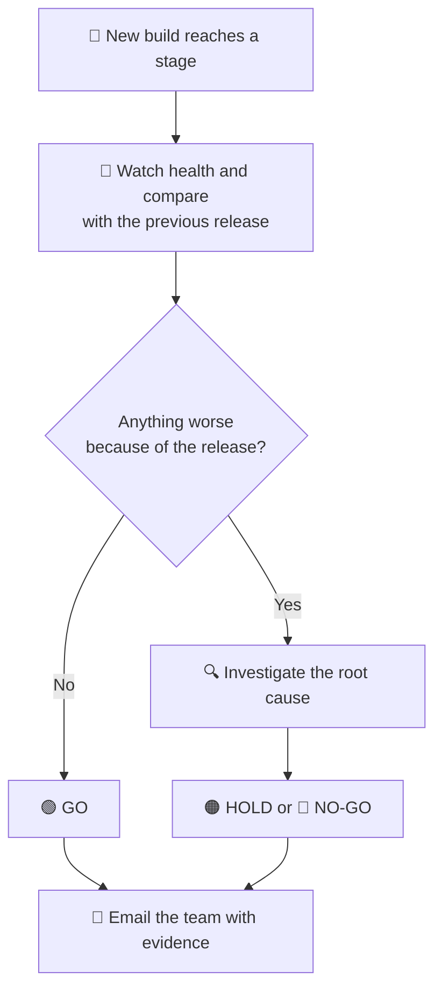

# ZED Release Health Check — High-Level Design

**Audience:** BCM team, release owners, and leads · **Status:** Approved and implemented · **Date:** 2026-10-29

For configuration, queries, and implementation details, see the [detailed design](./release-health-analysis.md).

---

## 1. The problem

Today, ZED deploys each monthly release through Canary, Low, Medium, and Heavy, but it cannot tell
whether the release is **healthy**. Before each promotion, the release owner checks the BCM Release
Health Dashboard by hand and decides whether to continue.

This approach has three gaps:

- **It is late.** Problems are often noticed only when someone opens the dashboard, sometimes after
  the next stage has already been promoted.
- **It is inconsistent.** Different owners look at different charts and draw different conclusions.
- **It does not explain anything.** A chart can show a spike, but not why it happened or which
  change caused it.

**Real example:** Release BCM2609-2 (build `3.0.881.0`) shipped an uncaught
`TaskCanceledException`. Telemetry clearly showed the problem in the Low stage, but the release
was still promoted to Medium and Heavy.

---

## 2. What ZED will do

After each stage is deployed, ZED will act as an **automated release health reviewer**:

1. **Watch** every stamp running the new build, starting within an hour of deployment.
2. **Compare** its health with the previous release to separate real regressions from normal noise.
3. **Investigate** each new or growing problem and identify the likely root cause and suspect change.
4. **Decide** on a clear **GO / HOLD / NO-GO** recommendation, with reasons.
5. **Notify** the team by email, and alert the on-call group immediately for serious problems.

ZED **recommends**; people **decide**. ZED never promotes, stops, or rolls back a rollout itself.

---

## 3. How it works

ZED uses the BCM telemetry the team already uses in Kusto. It knows exactly which build each stamp
is running, so it can tell precisely when each stamp received the new release.

---

## 4. When ZED checks

The goal is to catch problems **as early as possible**, rather than waiting until the end of
managed validation.

| When | What ZED does | Who hears about it |
|---|---|---|
| **~45 minutes after a stamp gets the new build, then every 30 minutes** | A quick health check that looks only for serious problems, such as crashes, role recycling, failure spikes, high CPU or memory, or a stamp going silent | **On-call group + release owner**, only if a serious problem is found |
| **After each backup cycle (about every 4 hours)** | A full health review, with an investigation of anything unusual | Release owner, only if something needs attention |
| **When managed validation for the stage completes** | Final review and **GO / HOLD / NO-GO** recommendation, before the next stage is promoted | **Whole release team** |

ZED waits for at least **two backup cycles (about 8 hours)** before it gives a GO. Some problems
appear only when scheduled backups run, as happened with BCM2609-2.

---

## 5. What ZED looks at

| Area | What ZED checks | In plain words |
|---|---|---|
| **Backups** | Failure rate, new error codes, duration, volume | Are backups failing more often or taking longer? Have backups stopped running? |
| **Restores** | Failure rate by restore type | Are restores failing more often? |
| **Protection** | Configure, modify, and stop protection results | Can customers still protect their VMs? |
| **Internal calls** | Failures and slowness when BCM calls CRP, Storage, Protection Service, and extensions | Did a dependency call start failing because of our change? |
| **Errors in logs** | New error messages that appear only on the new build | Is the new code throwing errors that the old code did not? |
| **Service upgrade** | Whether every Web and Worker role instance stopped cleanly and started successfully on the new build | Did the upgrade complete correctly, or is a role crashing or recycling? |
| **Machines** | CPU, memory, memory growth, and exception rate on each VM | Is the new build using more resources or leaking memory? |

**Customer errors are kept separate.** BCM already maintains a list of expected customer errors
(`ExpectedCloudErrors.xml`). ZED uses it to separate customer mistakes, such as a VM policy blocking
backup, from real service failures. This prevents customer noise from hiding a real regression.

---

## 6. How ZED decides whether something is a regression

A spike alone does not prove that the release caused a problem. ZED asks three questions:

1. **Is it worse than the previous release on the same stamp?** If it is **10% or more worse**,
   using the BCM team's rule, ZED investigates it.
2. **Is it also worse on stamps still running the old build at the same time?** If so, the cause is
   probably external, such as an Azure outage, rather than our release.
3. **Did it start after the new build arrived?** If it started earlier, our release did not cause it.

Only problems that are **worse on the new build, not on the old build, and started after the
deployment** are treated as caused by the release. This avoids blaming the release for outages,
holidays, or normal daily patterns.

---

## 7. The four possible outcomes

| Outcome | Meaning | What happens |
|---|---|---|
| 🟢 **GO** | No problems caused by the release, and enough data was collected. | The team can promote the next stage. |
| 🟠 **HOLD** | Something is at least 10% worse and is still being investigated, or the cause is unclear. | The release owner reviews ZED's investigation and either accepts the risk, with a recorded reason, or waits. |
| 🔴 **NO-GO** | A serious problem was confirmed and linked to the release. | **Do not promote.** The team is notified immediately. Any rollback is the team's decision. |
| ⚪ **INCONCLUSIVE** | ZED did not have enough reliable data, such as delayed telemetry or too few operations. | Treated as **not GO**. ZED explains what is missing and checks again. |

**Guardrails:**
- ZED can make a decision **stricter** after investigating, but it can never make a NO-GO softer.
- Only a person can override a HOLD or NO-GO, and every override is recorded with a name and reason.

---

## 8. How ZED investigates (root cause analysis)

ZED investigates each **distinct problem**, not each individual failure. For each problem, it:

1. **Finds the scope:** which stamps, roles, and machines are affected, and since when.
2. **Checks whether it is new:** whether the same issue existed on the previous release or last week.
3. **Follows the trail:** from failed operations to the internal call that failed, then to the
   detailed error logs and exact code location.
4. **Links it to code:** matches the failing code with the changes included in this release and
   names the likely pull requests and authors.
5. **Checks history:** determines whether the same issue occurred in a previous release.
6. **Concludes:** classifies the problem as release regression, external dependency, customer error,
   pre-existing issue, or not enough data, with a confidence level and a recommendation.

---

## 9. The email the team receives

**Subject:** [ZED] 🔴 NO-GO — Low stage health | BCM2609-2 *(illustrative, based on the BCM2609-2 replay in §10)*

> **Verdict: 🔴 NO-GO — do not promote Medium.**
> Build `3.0.881.0` · Low stage stamps on the new build: ea, wcus · about 20 h observed
>
> **Why:** A new `TaskCanceledException` error on CRP calls is occurring on the new build but not on
> stamps still running the previous build. It started 3.7 h after deployment, repeats with each
> backup cycle (bursts of up to about 4,000 errors), and is now present on **both** upgraded Low
> stamps.
>
> **Likely cause:** CRP request cancellation in `ExecuteV2Request` / `DeleteManagedRestorePoint`.
> Suspect change: *(PR and author from this release's commit list)*.
>
> **Health summary:** Backups ✅ · Restores ✅ · Protection ✅ · Internal calls ❌ · Errors ❌ ·
> Upgrade ✅ · CPU/Memory ✅
>
> **Evidence:** Each finding links to the Kusto query that proves it.

The email always contains the **verdict**, the **reasons**, a **health summary for each area**, the
**investigation for each problem**, items to **watch in the next stage**, and **links to the evidence**.

**Who receives it:**
- **Serious early warnings:** the smaller **on-call group** (configured during ZED setup) and the release owner.
- **Final verdicts:** the release team. HOLD, NO-GO, and INCONCLUSIVE also go to the on-call group and Teams.

---

## 10. Would this have caught the BCM2609-2 regression?

Yes. Replaying BCM2609-2 against real telemetry shows:

| When (2026) | What happened | What ZED would have done |
|---|---|---|
| Sep 15–16 · Canary | A burst of new `TaskCanceledException` errors appeared on one canary machine. | 🟠 **HOLD**: a new error, still being investigated |
| Sep 19, 12:20 · Low deployed | No errors for the first 3.7 hours | Keep watching. A GO cannot be given before about 8 hours. |
| Sep 19, ~16:45 | 3,966 errors on 12 machines during a scheduled backup cycle | ⚠️ **Early warning** to on-call, about 4.4 h after deployment |
| Sep 20, ~08:45 | Errors spread to a second Low stamp | 🔴 **NO-GO**: do not promote |
| Sep 22 · Medium promoted | *(Actual history: promoted despite the issue)* | ZED would already have said NO-GO for **about 2 days** |
| Sep 23 · Heavy promoted | *(Actual history)* | About **3.5 days** of warning before Heavy |

Across the Low and Medium stamps between Sep 19 and Sep 23, the new build produced about
**86 times more** of these errors per operation than stamps still on the previous build.

**Confirmed with the implemented engine** (backtests on live telemetry, BCM's `bcm-release-health` skill):

| Release | Check | Verdict | Why |
|---|---|---|---|
| BCM2609-2 (3.0.881.0), Low stamps ea + wcus, as of Sep 20 08:45 | final | 🔴 **NO-GO** | Six serious findings on the new build only (control unchanged): the `…AggregateException … TaskCanceledException` error log (new, 1,007 vs 0), `CloudServiceRetryableError` logs ~75–140× and sub-operation failures ~76×; CRP call latency 2–5× slower |
| BCM2610_2 (3.0.886.0), 19 Day2 stamps, as of Oct 30 12:00 | final | 🟠 **HOLD** (owner only) | Three protection findings for RCA (`CatalogInternalError`, `CloudInternalError`, `jpe` protection failures) — the earlier manual RCA traced these to single customers / issues that began before the upgrade, so the owner accepts them (`health accept`) and the stage is GO. Backups, restores, sub-operations, latency, error logs, CPU/memory and upgrade health all passed |

Each full check takes about 5–7 minutes.

---

## 11. Adding other services

All service-specific information lives in a **per-service configuration file**. This includes the
tables to query, the error list, start-failure messages, thresholds, and the on-call group. ZED's
setup wizard asks for these details when a service is onboarded. A new service can use the health
check **without changing ZED itself**.

---

## 12. Rollout plan

| Phase | What happens |
|---|---|
| **1. Build & replay** | Build the health check and replay past releases, including BCM2609-2 and BCM2610_2, to tune it. |
| **2. Shadow mode** (1–2 releases) | ZED sends its verdict only to the release owner, who continues to use the dashboard and compares the results. |
| **3. Team advisory** | Verdicts and early warnings go to the team and on-call group. |
| **4. Required acknowledgement** | A HOLD or NO-GO requires a recorded response from the owner before ZED proceeds. ZED still never stops a rollout. |
| **5. More services** | Onboard other services through configuration only. |

---

## 13. Decisions made with the BCM team

| Topic | Decision |
|---|---|
| Canary stamps | `ea-can02`, `ecy-pod01`, `ccy-pod01` |
| Which build is analysed | Only the **exact build deployed by ZED**; private and developer builds are ignored |
| Customer vs service errors | Use `ExpectedCloudErrors.xml` (`<UserError>true</UserError>`) |
| When to investigate | A change of **10% or more** compared with the previous release |
| Upgrade failures | Use the Web and Worker role `OnStart threw exception, role recycling` messages |
| CPU and memory | Use VM-level counters from `CounterEventsLocalAllClusters` |
| Automation limit | **NO-GO is notification only.** ZED never stops or rolls back a rollout. |
| Early-warning audience | A separate, smaller **on-call group**, configured during setup |
